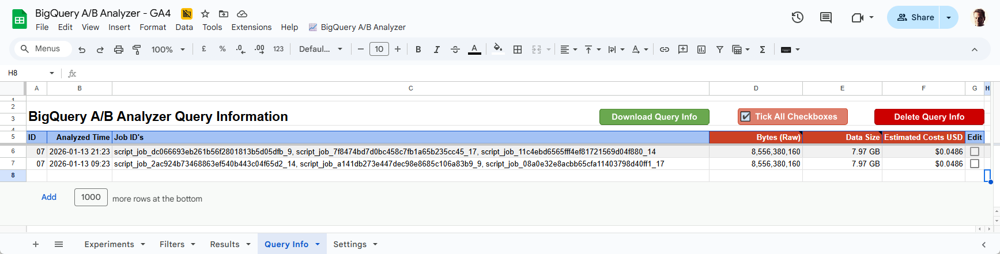

# User Manual: BigQuery A/B Analyzer

## 1. Introduction

The **BigQuery A/B Analyzer** is a tool that allows you to define, manage, and analyze A/B variants directly from Google Sheets. It connects to BigQuery, applies rigorous statistical analysis (Welch’s T-test & Z-tests), and returns the results without you needing to write SQL.

## 2. Setup

* [**Google Cloud**](Google-Cloud)
* [**Settings** sheet](Google-Sheet/Settings-Sheet)

## 3. The Workflow

This tool uses a manual "sync" model to give you control over costs and timing. It does not update automatically in the background.

### Step A: Initialize onEdit Trigger

Filtering and funnels requires a special **onEdit** trigger.

1. Click the menu 📈 **BigQuery A/B Analyzer** at the top.
2. Select **Settings > Initialize onEdit Trigger**.

Wait for the "toast" notification at the bottom right confirming success. You only need to do this the first time you are using the Google Sheet.

### Step A: Refresh Metadata

To see the latest event names and parameters in your dropdown menus, you must pull metadata from BigQuery.

1. Click the menu 📈 **BigQuery A/B Analyzer** at the top.
2. Select **Get Data from BigQuery > Refresh Events**.
3. Select **Get Data from BigQuery > Refresh Parameters**.

Wait for the "toast" notification at the bottom right confirming success.

### Step A: Export Settings to BigQuery

1. You turn **AI Summary** on and off in **Settings** tab.
2. The **AI Prompt** instructs how Gemini should interpret the result.
3. Click the menu 📈 **BigQuery A/B Analyzer** at the top.
4. Select **Settings > Export Settings**.

This saves the AI Summary settings and the BigQuery region (**Data Set Location**) to BigQuery. Do this again if you change these settings.

Wait for the "toast" notification at the bottom right confirming success.

### Step B: Configure the Test
Fill out a row in the Experiments tab (see [**Experiments sheet**](Google-Sheet/README.md#experiments-sheet) and configure [**Filters**](Google-Sheet/README.md#filtering) for details).

Set **Total target sample** for the experiment. Use the **Pre-Test Calculator** to find the sample size, and add about 20%. The target sample is used by **sequential monitoring**, which makes it safe to check the results every day.

### Step C: Run Analysis

* Set the **Analyze** column (Column J) to **"Yes"**.
* Go to 📈 **BigQuery A/B Analyzer > Analyze A/B Variants in BigQuery**.
* **Confirm**: A popup will summarize the job (e.g., *"Executing 1 analysis query..."*). Click **Yes**.
	* The system validates your inputs, uploads the config to BigQuery, and runs the statistics.
	
### Step D: View Results
Once the job finishes, you can download the data manually into the **Results tab** or view the result in **Data Studio**.

* Green: Statistically Significant result.
* Red: Not Significant.
* Grey: Not Evaluated (not enough data).
* **Warnings** column: Explains when the test assumptions do not hold (Credit Both, date comparison or Sample Ratio Mismatch). See [FAQ: What does the Warnings column mean?](../README.md#138-what-does-the-warnings-column-mean)

## 4. Handling User Overlap

What happens if a user is seen in both Variant A and Variant B? Use the **User Overlap** column (Column AB) to decide.

### Which Logic to Use?
<table>
  <thead>
    <tr>
      <th scope="col" style="text-align: left;">Scenario</th>
      <th scope="col" style="text-align: left;">Recommended Setting</th>
      <th scope="col" style="text-align: left;">Logic Explanation</th>
    </tr>
  </thead>
  <tbody>
    <tr>
      <th scope="row" style="text-align: left;">Standard A/B Test</th>
      <td>🛡️ Exclude</td>
      <td>Removes overlapping users entirely. Ensures scientific purity. Credit Both may also be used if you are sure there are no overlapping users. Credit Both will always show a warning, since overlapping users make the groups dependent.</td>
    </tr>
    <tr>
      <th scope="row" style="text-align: left;">Date Comparison</th>
      <td>🤝 Credit Both</td>
      <td>Counts the user in both time periods (e.g., Jan & Feb). Necessary to track returning users accurately.</td>
    </tr>
    <tr>
      <th scope="row" style="text-align: left;">Onboarding / UI Test</th>
      <td>🥇 First Exposure</td>
      <td>Attributes users to the <em>first</em> version they saw. Good if the first impression is what matters.</td>
    </tr>
    <tr>
      <th scope="row" style="text-align: left;">Zero Overlap Check</th>
      <td>🤝 Credit Both</td>
      <td>Use this to verify your data is clean. If your traffic splitter works, A and B should have 0 users in common.  
Can also be used for analysing standard A/B tests where a A/B test tool has been used to distinguish users between variants.
</td>
    </tr>
    <tr>
      <th scope="row" style="text-align: left;">Banners / Messaging</th>
      <td>🔄 Last Exposure</td>
      <td>The <strong>"Recency" View</strong>. Attributes users to the <em>last</em> version they saw. Use this for ephemeral content (e.g., "Free Shipping" banners) where the most recent offer likely caused the sale.</td>
    </tr>
  </tbody>
</table>

## 5. BigQuery and estimating size/cost of query

Since it isn't possible to see an estimate of how large the query will be in Google Sheet before you run it, the following approach is recommended:

1. Go to **Settings** sheet.
	* In **Query Information** section, make sure the **Log Query Information** checkbox is ticked, and that a value is filled out for **On-demand Pricing for Queries**. 
		* At the time of writing, the value is **6.25**. See [**BigQuery On-demand Queries pricing for US**](https://cloud.google.com/bigquery/pricing?hl=en).
2. Run the analysis only for a short time period (ex. 1 day).
3. After the query has completed, go to the **Query Info** sheet, and click the **Download Query Info** button.
	* If no info about the query is downloaded, give it some more time and try again.

By using this approach, you will get a feeling of how large the final query will be and potential cost.

### About size and cost estimation

* Cost estimation is a calculation of potential cost based on the size of the query. It's not a measurement of exact cost.
* Analysis of A and B, and the final merge, are the "actions" measured in the calculation.
	* Other actions like checking if table(s) exist are not included in the calculation. These other actions only adds a few extra MB and microscopic to no cost.
	
## 6. BigQuery minimum permissions needed

To use the solution (run analysis), these are the minimum BigQuery permissions needed for the end user.

<table>
  <thead>
    <tr>
      <th scope="col" style="text-align: left;">Role Name</th>
      <th scope="col" style="text-align: left;">Role ID</th>
      <th scope="col" style="text-align: left;">Capability</th>
    </tr>
  </thead>
  <tbody>
    <tr>
      <th scope="row" style="text-align: left;">BigQuery Job User</th>
      <td><code>roles/bigquery.jobUser</code></td>
      <td>Run SQL queries (Compute)</td>
    </tr>
    <tr>
      <th scope="row" style="text-align: left;">BigQuery Data Editor</th>
      <td><code>roles/bigquery.dataEditor</code></td>
      <td>Create, Write, & Delete Staging Tables</td>
    </tr>
    <tr>
      <th scope="row" style="text-align: left;">BigQuery Data Viewer</th>
      <td><code>roles/bigquery.dataViewer</code></td>
      <td>Read source data only (Read-only)</td>
    </tr>
  </tbody>
</table>

## 7. Troubleshooting

<table>
  <thead>
    <tr>
      <th scope="col" style="text-align: left;">Issue</th>
      <th scope="col" style="text-align: left;">Likely Cause</th>
      <th scope="col" style="text-align: left;">Solution</th>
    </tr>
  </thead>
  <tbody>
    <tr>
      <th scope="row" style="text-align: left;">Result is NOT_EVALUATED</th>
      <td>Insufficient data or logic error.</td>
      <td>Check if the date range covers actual data.   Check if your Regex is valid.</td>
    </tr>
    <tr>
      <th scope="row" style="text-align: left;">Variant B has 0 users</th>
      <td>Wrong Parameter Key.</td>
      <td>Check Column Z (Exp. Variant Param). Are you looking for <strong>color</strong> but the DB calls it <strong>button_color</strong>?</td>
    </tr>
    <tr>
      <th scope="row" style="text-align: left;">Conversion Rate > 100%</th>
      <td>Scope is set to EVENT.</td>
      <td>This is normal for EVENT scope (e.g., 2.5 videos watched per user).</td>
    </tr>
    <tr>
      <th scope="row" style="text-align: left;">Dropdowns are empty</th>
      <td>Metadata not synced.</td>
      <td>Run Get Data from BigQuery > Refresh Events/Parameters.</td>
    </tr>
    <tr>
      <th scope="row" style="text-align: left;">Result is NOT_SIGNIFICANT, but the p-value is below 0.05</th>
      <td>Sequential monitoring. The target sample is not reached yet.</td>
      <td>This is expected. Early in the test, the p-value must be lower. The details text shows how much of the target sample is collected, e.g. "No significant difference (26% of target)". Let the test run, or check <strong>Total target sample</strong>.</td>
    </tr>
    <tr>
      <th scope="row" style="text-align: left;">Warnings shows Sample Ratio Mismatch</th>
      <td>The traffic split between A and B differs from the expected split (50/50 as default).</td>
      <td>Check the A/B test tool, tracking of the experiment event and filters. If the split is meant to be different, change <code>srm_expected_share_b</code> in the scheduled query.</td>
    </tr>
    <tr>
      <th scope="row" style="text-align: left;">Scheduled query error: "Experiment X has no source table"</th>
      <td>The experiment was exported to BigQuery before v2.4, or BigQuery Data Set ID / Table ID is empty in Settings.</td>
      <td>Check <strong>BigQuery Data Set ID</strong> and <strong>BigQuery Table ID</strong> in the Settings sheet, and analyze the experiment again.</td>
    </tr>
    <tr>
      <th scope="row" style="text-align: left;">AI Summary is not updated</th>
      <td>Gemini rejected the request (e.g. "Exceeded rate limits").</td>
      <td>The query tries again up to 3 times. If it still fails, the analysis is saved and the previous AI Summary is kept. Run the analysis again later.</td>
    </tr>
    <tr>
      <th scope="row" style="text-align: left;">"Block Skipped" Error</th>
      <td>Missing required fields.</td>
      <td>Ensure Name, ID, Dates, and Variant Strings are filled for both rows.</td>
    </tr>
  </tbody>
</table>

<!-- footer:start -->

---

Solution by [**Eivind Savio**](https://www.savio.no/?utm_source=github.com&utm_medium=referral&utm_campaign=knowit-ai-analytics&utm_content=bigquery-ab-analyzer) from [**Knowit AI & Analytics**](https://www.knowit.no/?utm_source=github.com&utm_medium=referral&utm_campaign=knowit-ai-analytics&utm_content=bigquery-ab-analyzer) (Oslo, Norway). Not officially supported by Knowit.

<!-- footer:end -->
