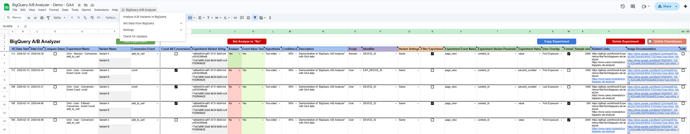
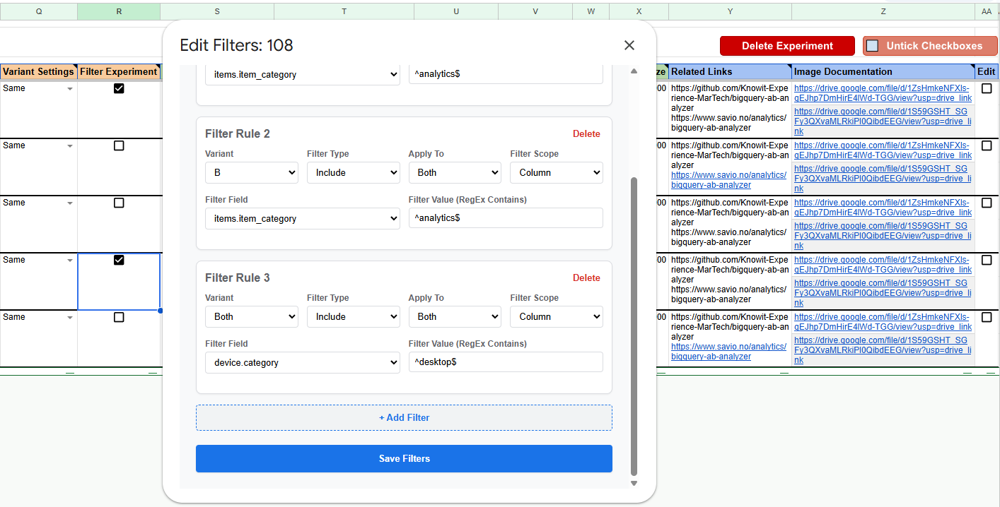
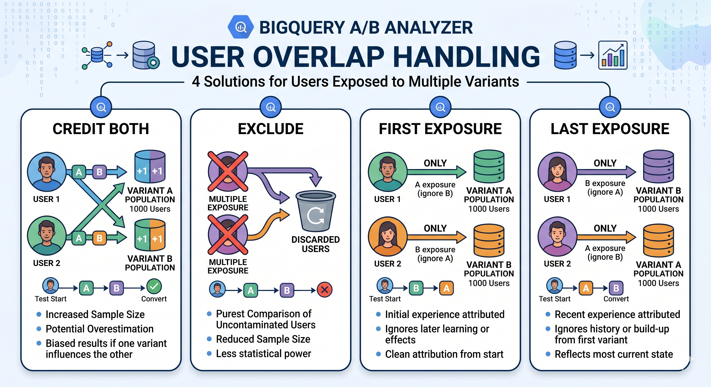
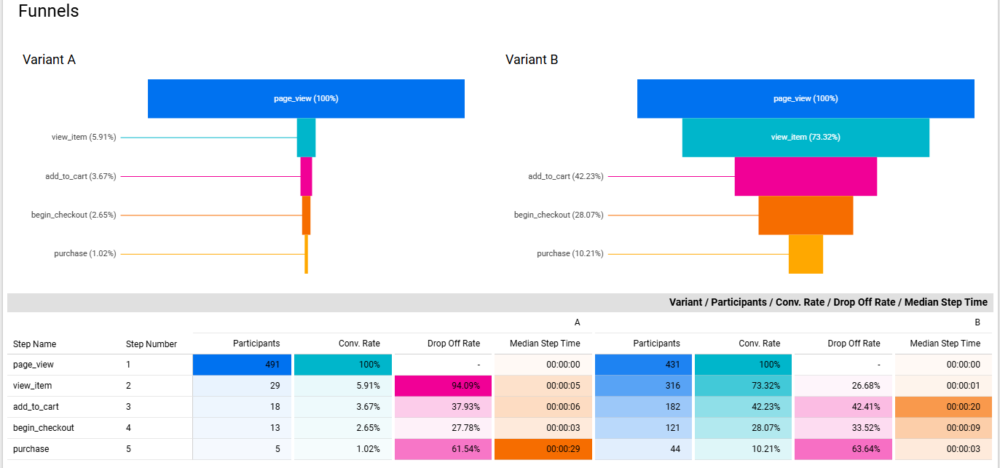
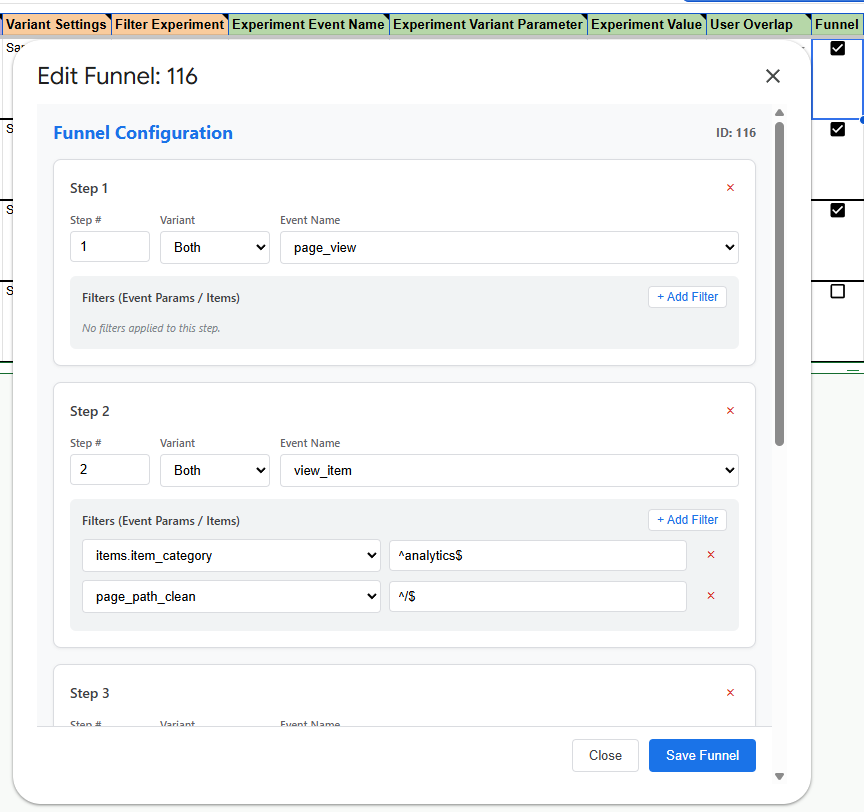
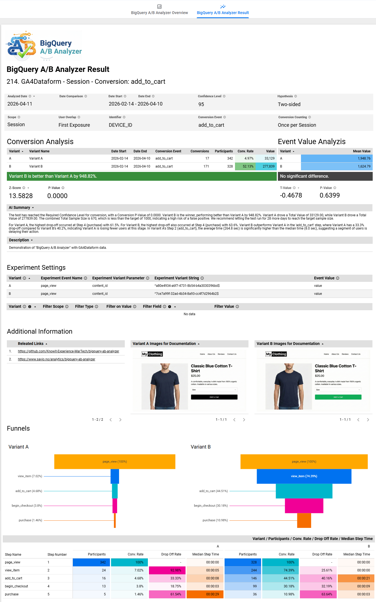
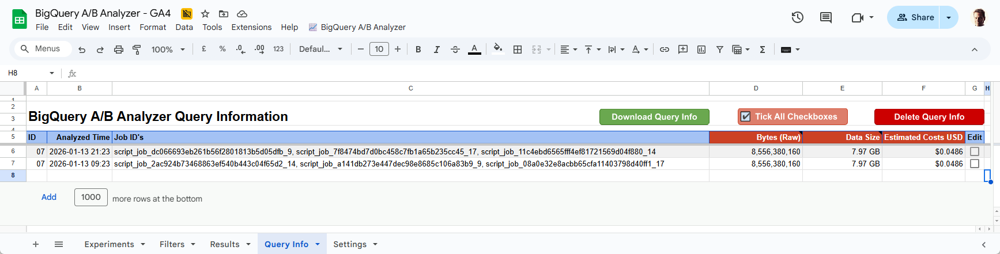
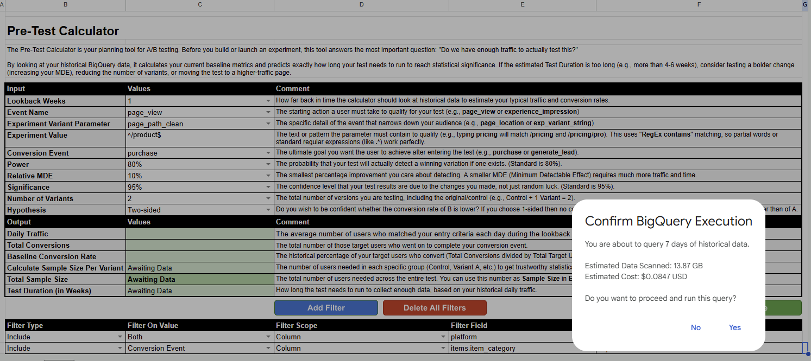
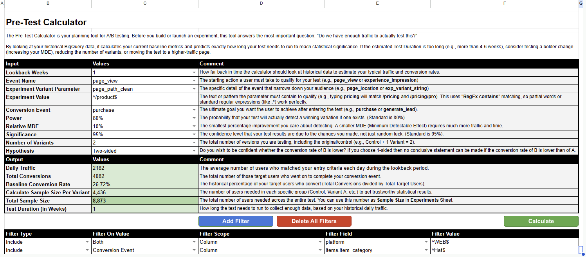
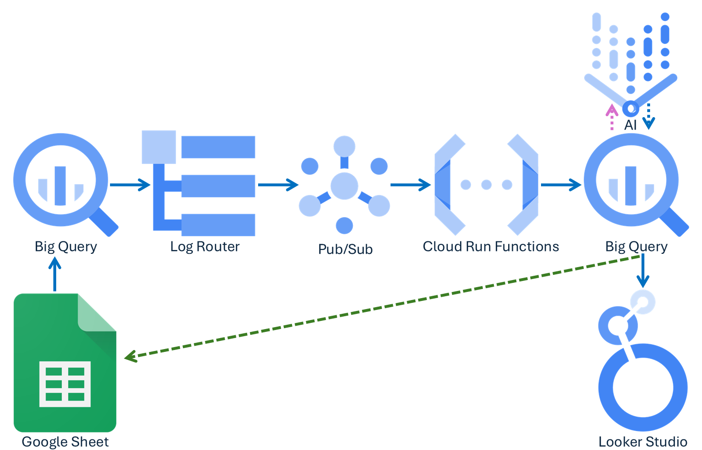

# BigQuery A/B Analyzer

## 1. Overview

A scalable, configuration-driven framework for running rigorous A/B analysis directly on BigQuery data.

The **BigQuery A/B Analyzer** decouples experiment definition from execution. It allows analysts and product owners to run sophisticated statistical analyses on millions of rows without writing a single line of SQL.

The framework supports the following tools:
* [Google Analytics](https://marketingplatform.google.com/about/analytics/) (GA4)
	* [Firebase](https://firebase.google.com/docs/ab-testing/bigquery)
 		* Supports Firebase experiment structure in BigQuery.
* [GA4Dataform](https://ga4dataform.com/) by Superform Labs
	* Flattened GA4 tables that are faster and more affordable to query.
* [Amplitude](https://www.amplitude.com/)
* [Mixpanel](https://mixpanel.com/home/)
* [PostHog](https://posthog.com/)

The solution is built around **Google Sheet**, **BigQuery**, **Gemini AI** and **Data Studio**.

## 2. Getting Started

1. Setup:
	1. [Google Cloud](01-Documentation/Google-Cloud)
		* [AI Summary](01-Documentation/Google-Cloud/03-AI-Summary) (Optional)
	2. [Settings sheet](01-Documentation/Google-Sheet/Settings-Sheet)
2. [Documentation / using the Google Sheet solution](01-Documentation)
3. [Data Studio / presenting results](01-Documentation/Data-Studio)

## 3. Upgrading
* [v2.4 is latest version](../../releases/tag/v2.4).
* [How to upgrade to v2.4](03-Releases/v2.4).

## 4. The "Backbone": Configuration-Driven Architecture

The backbone of the system is the **Experiments Google Sheet**, which acts as a centralized registry.

* **Dynamic Scope**: You can define experiments based on URL patterns (regex) or specific event parameters or user properties.
* **Statistical Rigor**: You define the confidence level (e.g., 95% or 99%) and hypothesis type (One-sided vs. Two-sided) directly in the sheet.
* **Metrics on Demand**: You can switch between analyzing conversion rates (User X did Y) or continuous values (User X spent $Y) simply by changing a dropdown.

## 5. Key Technical Capabilities

The solution includes advanced data cleaning and filtering features.

### Filters: The "Precision Lens"

The Filters feature allows you to move beyond monolithic data by isolating specific user segments or behavior patterns directly from the spreadsheet.

* **Segmented Analysis**: Zoom in on specific audiences by including or excluding users based on device, geography, or traffic source (e.g., "Only count Mobile users").
* **Nested Ecommerce Deep-Dives**: You can filter by eg. <code>items.item_id</code>, <code>items.item_category</code>, or <code>items.item_brand</code> to see if a variant specifically boosted the conversion rate of a particular product or category. 
* **Flexible Logic**: Supports both Event and User scopes, utilizing Regex for sophisticated matching (e.g., "Exclude customer type A" or "Include only specific sub-domains").
* **No Re-Coding Necessary**: Stakeholders can pivot from a site-wide analysis to a product-specific deep dive instantly, simply by updating a row in the configuration.

### User Overlap: The "Quality Control" Referee

Since this framework can analyze "natural" experiments, users might occasionally see both Version A and B.

* **The Logic**: Identifies "confused" users and applies a strict rule set to disqualify them, ensuring your results are statistically pure and free of noise.
	* **Exclude**: Remove them entirely (Scientific purity).
	* **Credit Both**: Useful for time-period comparisons.
	* **First/Last Exposure**: Attribute them to the first or last version they saw.
	

### Metric Flexibility: Beyond Simple Conversion Rates

Most A/B testing tools force you into a binary world: a user either converted or they didn't. But for many products, the *volume* of engagement could matter just as much as the *act* of engagement.

This solution allows you to toggle between three distinct counting methods:

1. **User Conversion Rate (Standard)**:
	* *Question*: "What % of distinct users performed the action?"
	* *Math*: Capped at 100%. (1 User = 1 Conversion, even if they clicked 10 times).
	* *Best for*: Sign-ups, subscriptions.
2. **Session Conversion Rate**:
	* *Question*: "In what % of sessions did this event occur?"
	* *Math*: Capped at 100% per session.
	* *Best for*: Landing page optimization, search usage.
3. **Total Event Rate (Count All Conversions)**:
	* *Question*: "How many times did this action happen *per user*?"
	* In this mode, the result is an **Event Rate**, not a probability. It could be perfectly normal to see a rate of 150%. This simply means the average user performed the action 1.5 times.
	* *Math*: The solution switches statistical gears here. Instead of a standard Z-test for proportions, it uses **Welch's t-test** on the number of conversions per participant, to accurately compare the intensity of user behavior, not just the presence of it.
	* *Best for*: Media consumption (Videos watched per user), E-commerce (Items added to cart), or Gaming (Levels played).
	
#### Why this distinction is critical

If you only measure "Did they click?", you might miss a huge win.

* **Scenario**: Variant A and Variant B both have 50% of users clicking "Play".
	* *Standard Tool Result*: "No Difference".
* **Reality**: In Variant B, those users watched 5 videos each, whereas in Variant A they only watched 1.
	* *This Solution's Result*: "Variant B has a 400% higher Event Rate per User".

### Item Metrics: Items sold and item revenue

The value test can also measure **items** instead of the event value. This answers questions like *"Did variant B sell more items from category X, and did the item revenue increase?"*

1. Add an item filter on the **conversion event**, e.g. `items.item_category` = `^Shoes$`.
2. Set **Experiment Value** to an item field:
	* `items.quantity`: Number of items sold.
	* `items.item_revenue`: Item revenue. If `item_revenue` is missing, `price × quantity` is used.

Only items matching the item filter are counted. A basket with 1 pair of shoes and 3 shirts counts 1 item and the revenue of the shoes.

You then get 3 answers from 2 experiments (copy the experiment and change **Experiment Value** in the copy):

* **Conversion test**: Did B get more participants to buy something from the category?
* **Value test with `items.quantity`**: Did B sell more items from the category per participant?
* **Value test with `items.item_revenue`**: Did B bring in more revenue from the category per participant?

Item metrics are supported for all tools. For Amplitude, Mixpanel and PostHog, use the item price field (e.g. `products.price`). Price is multiplied by quantity.

### User Flexibility: You define what a user is

The framework supports 4 different methods for identifying/analysing users:

1. **DEVICE_ID**: Default method for the select tool to count and identify users. Ex. **GA Client ID**.
2. **USER_ID**: Your own identifier with individual users Ex. **GA User-ID feature**.
3. **USER_ID_OR_DEVICE_ID**: Uses User ID if it exists, if not it fallbacks to Device ID.
4. **EXP_DEVICE_ID**: Bring your own ID, ex. Cookie ID from the A/B test tool. Full name: Experience Device ID.

### Your Personal Analyst: AI Summary

* **AI Summary** is powered by [**Gemini**](https://docs.cloud.google.com/gemini-enterprise-agent-platform/models/google-models). Gemini is interpreting the test, and summarises the result with recommendations.
* Gemini is only interpreting the result, so the size of the data analysed will not affect the cost.
* AI Prompt can be edited in Google Sheet.
* Gemini is told exactly what the value measures (e.g. revenue or items sold), and gets the likely range, warnings and Sample Ratio Mismatch check.
* AI Summary functionality is optional.

### Funnel Analysis: Identifying Drop-off Points

The framework supports multi-step funnel analysis to visualize the user journey and identify precisely where friction occurs.

* **Variant-Specific Funnels**: This architecture allows you to map distinct paths for A and B. This is ideal for testing entirely different architectural flows (e.g., Variant B skips a step or uses a different checkout sequence).
* **Secondary Goals & Behavioral Shifts**: Use the funnel engine to track complex secondary goals, such as ensuring a new "Recommendations" widget isn't cannibalizing primary product sales by monitoring side-by-side progression rates.
* **Detailed Funnel Metrics**: The tool calculates conversion rates, drop-off percentages, and the time spent (both average and median) between every stage of the journey.
* **Deep Insights**: Evaluate specific use cases like Onboarding Flows (did users watch the tutorial before setup?) or Feature Adoption (does engaging with a search filter lead to higher purchase rates down-funnel?).

* This is a **closed funnel**.
* **Gemini** is instructed to analyse funnels if activated.
* Time is calculated from the first time a user interacted with the **event** in the funnel in the analysed period.
	* If your analysis is **User Scoped**, the time will tell you about user behaviour. Ex. user starts the funnel (view_cart), leaves the site and comes back 2 hours later and completes the funnel (view_cart -> begin_checkout -> purchase). Time between <code>view_cart</code> and <code>begin_checkout</code> will be 2 hours.
	* If you want to understand friction in the funnel itself, a **Session Scoped** analysis may work better.

## 6. The Statistical Engine (Calculation Method)

This is where the "magic" happens. The solution does not just count clicks; it uses a set of custom **User Defined Functions** (UDFs) in BigQuery to determine mathematical certainty based on the data type.

All tests are done **per participant** (user or session). A user with 5 purchases is one participant with 5 conversions, not 5 independent observations.

1. **For User Conversion (Proportions)**
	* *Method*: [Two-Proportion Z-Test](https://en.wikipedia.org/wiki/Two-proportion_Z-test) (Pooled Variance). Chosen for its objectivity and efficiency at Big Data scale. It provides clear P-values without the computational overhead of Bayesian simulations.
	* *Use Case*: Answering "Did more people sign up?" (Yes/No metrics).
	* *How it works*: Used when **Count All Conversions** is not ticked. It calculates a Z-score to measure the difference between two probabilities, strictly capped at 100%.
2. **For Event Frequency (Intensity)**
	* *Method*: [Welch's t-test](https://en.wikipedia.org/wiki/Welch%27s_t-test) on the number of conversions per participant.
	* *Use Case*: Answering "Did users watch more videos?" or "Did they add more items to the cart?"
	* *How it works*: Used when **Count All Conversions** is ticked, and metrics can exceed 100% (e.g., 2.5 plays per user). Because the test is done per participant, a few heavy users can't create a significant result alone.
3. **For Continuous Metrics (Values)**
	* *Method*: [Welch's t-test](https://en.wikipedia.org/wiki/Welch%27s_t-test), with p-values from the Student t distribution.
	* *Use Case*: Answering "Did users spend more money?" or "Did page load time decrease?"
	* *What is compared*: **Value per participant**. Participants without a conversion count as 0. This answers "Which variant brings in more value per user/session?". **Value per conversion** (average order value) is used by the AI Summary to explain if the lift comes from more conversions, bigger conversions or both.
	* *Why Welch's?* Standard t-tests assume both groups have the same variance (spread). In real user data, this is rarely true (e.g., a few "whales" spend a lot). Welch's t-test is designed to be reliable even when groups have unequal variances and unequal sample sizes.

### Sequential Monitoring: Check the results every day

Most people look at A/B test results while the test is running. With a classic (fixed horizon) test, stopping the moment you see "Significant" increases the risk of a **False Positive**.

This solution uses **sequential monitoring** (an O'Brien-Fleming type boundary). The p-value needed to declare a winner depends on how much of the **Total target sample** has been collected:

* Early in the test, the bar is high. Only very clear results are SIGNIFICANT.
* At the target sample, the bar is close to the normal confidence level (e.g. 95%).
* A SIGNIFICANT result is valid to act on, even before the target sample is reached. You can stop the test.

When a result has a low p-value, but not low enough yet, the details text explains it, e.g. *"No significant difference (26% of target)."* The required p-value is stored in `sequential_alpha`, and is given to the AI Summary.

Sequential monitoring can be turned off in the scheduled query.

### Likely Range (Confidence Interval)

The lift is reported with a **likely range**, e.g. *+7.1% (likely range +4.4% to +9.8%)*. The likely range is used by the AI Summary, and is available in BigQuery and Data Studio.

### Quality Checks and Warnings

* **Sample Ratio Mismatch (SRM)**: Checks if the traffic split between A and B is what you expect (50/50 as default). If the split is broken (p < 0.001), the result should not be trusted, regardless of significance.
* **Warnings**: Explains when the test assumptions do not hold. The results are still calculated.
	* **Credit Both**: Participants exposed to both variants are counted in both groups, so the groups are not independent.
	* **Date comparison**: The variants ran in different periods, so a difference can also come from seasonality, campaigns or other changes.
	* **Sample Ratio Mismatch**.

### Automatic Significance Detection 

Every time you run the analysis, the system outputs a clear verdict:

* SIGNIFICANT: The difference is real; you can trust it.
* NOT_SIGNIFICANT: The difference could be due to luck; do not make a decision yet.
* NOT_EVALUATED: Insufficient data to make a call.

## 7. Reporting

Analysed data can either be downloaded to the Google Sheet, or shown in a Data Studio dashboard. 

The Data Studio dashboard is designed to answer "Who won?" at a glance.

## 8. Query Information
Before running a massive historical analysis, you can toggle the **Query Information** feature. Run a 1-day sample to see the estimated size and cost, ensuring no BigQuery billing surprises.

## 9. Pre-Test Calculator

The Pre-Test Calculator is a planning tool for A/B testing. Before building or launching an experiment, this tool answers the question: "*Do we have enough traffic to actually test this?*"

By looking at historical BigQuery data, it calculates current baseline metrics and predicts how long the test needs to run to reach statistical significance. This information can also be used to inform AI Summary about the Sample Size that should be used in the evaluation of the analysis.

## 10. Analysis vs. Orchestration

This solution is a statistical analysis engine, not a traffic splitting tool.

* **What it DOES NOT do**: It does not randomize users or serve different content versions on your website/app. You must use an existing mechanism (e.g., Firebase Remote Config, Optimizely, Kameleoon, Conductrics, GrowthBook or other solutions for A/B testing) if you want to orchestrate a controlled split.
* **What it DOES do**: It acts as a universal statistical layer for your analytics. It can analyze almost any event or user segment in GA4, Firebase, GA4Dataform, Amplitude, Mixpanel or PostHog against statistical significance. Whether you are validating a formal A/B test, comparing time periods, or analyzing natural user cohorts, it ensures your insights are backed by rigorous math.

## 11. Setup

Image below illustrates the setup.

## 12. Prerequisites

* Access to BigQuery and your raw event data.
* Basic understanding of your event parameters.
* Ability to write simple Regular Expressions (Regex).
* *SQL competence is NOT required*.

## 13. FAQ

### 13.1. Can I "peek" at the results before the test is finished?
**Yes**. The framework uses **sequential monitoring**, which is designed for checking the results every day. A SIGNIFICANT result is valid to act on, even before the target sample is reached. Early in the test, the p-value needed is much lower than normal, so only very clear results are SIGNIFICANT. See [Sequential Monitoring](#sequential-monitoring-check-the-results-every-day).

Sequential monitoring only works if **Total target sample** is set for the experiment. If sequential monitoring is turned off in the scheduled query, the test is a classic **Fixed-Horizon** test, and looking at the results daily increases the risk of a **False Positive** ([Type 1 error](https://en.wikipedia.org/wiki/Type_I_and_type_II_errors)).

### 13.2. How do I know when the sample size is "enough"?
Define your target sample size before you run the analysis using **Pre-Test Calculator**, and add about **20%**. Sequential monitoring needs a slightly larger sample than a fixed horizon test to detect the same effect.

* **Small changes** require many users.
* **Big changes** (e.g., a completely new UI) require fewer.
* Set **Total target sample** for the experiment. It is used both by sequential monitoring and by **AI Summary**.
* If the target sample is reached and the result is still NOT_SIGNIFICANT, close the test as inconclusive.

### 13.3. Why doesn’t this solution use Bayesian "Probability of Winning"?
Bayesian models are good for storytelling ("There is a 92% chance B is better than A"), but they are computationally expensive to run in a data warehouse. The **Two-Proportion Z-Test** was chosen because it is statistically equivalent for making business decisions while being much faster to compute in BigQuery. It allows you to analyze massive datasets without the "cost-creep" associated with more complex simulations.

### 13.4. What if the result is "NOT_SIGNIFICANT"?
This doesn't mean the test failed! It means that, based on the current data, the difference between Version A and Version B is too small to distinguish from random noise. You should either:

* Continue the test to gather more data (if you haven't reached your sample size).
* Declare a "Draw" and move on to the next hypothesis.

### 13.5. Can other tools be supported?
If the tool is having the same event data model as the already supported tools, and can export data to BigQuery, the tool can be supported.
However, since the BigQuery schema will be different, the following have to be adapted:
* **BigQuery**
	* [BigQuery Scheduled Query](01-Documentation/Google-Cloud/01-BigQuery/01-Scheduled-queries)
* **Apps Script**
	* [01_Generic.gs](01-Documentation/Google-Sheet/Apps-Script/01_Generic.gs)
	* [04_BigQuery_Download.gs](01-Documentation/Google-Sheet/Apps-Script/04_BigQuery_Download.gs)
	* [05_BigQuery-Results.gs](01-Documentation/Google-Sheet/Apps-Script/05_BigQuery-Results.gs)

### 13.6. Can I analyse A/B/C?
This framework only support analysis of 2 variants.

If you need to analyse more than 2 variants, you must do this as individual analysis:

* A vs. B
* A vs. C
* B vs. C
	
### 13.7. Should I use events_ or events_fresh_?
GA4 360 properties can use the [**Fresh Daily**](https://support.google.com/analytics/answer/15604391) export (`events_fresh_`) in addition to the daily export (`events_`). You select the table in **BigQuery Table ID** in the **Settings** sheet.

The 2 tables will not give exactly the same numbers. Google states that the difference is often as low as 2%. In a test with both tables, the conclusion was the same, but the numbers differed by about 3%.

**Recommendation**: Both work well for A/B analysis. An A/B test compares A with B, and the difference between the tables affects both variants about equally.

* **events_fresh_** is the more complete version. It is rebuilt once a day with finalized sessions and user data, and is normally complete by 5 AM. Use it if you have it.
* **events_** is available for all GA4 properties, and is the default.
* **Pick one table per experiment, and keep it for the whole test.** Switching table while the test is running can move the numbers by a few percent for reasons that have nothing to do with the test.
* Don't compare absolute numbers between reports that use different tables.

Things to know about **events_fresh_**:
* Only available for GA4 360 properties (Normal and Large, not XL).
* Google has no Service Level Agreement (SLA) for the Fresh Daily export.
* Traffic source for recent Google Ads events may show "Data Not Available", because the export can run before Google Ads attribution is finished. This only matters if you filter on traffic source.

### 13.8. What does the Warnings column mean?
The **Warnings** column explains when the test assumptions do not hold: **Credit Both**, **date comparison** or **Sample Ratio Mismatch**. The results are still calculated, but should be interpreted with care. If **Sample Ratio Mismatch** is detected, fix the traffic split before you trust the result.

## 14. Summary of Benefits

* **Democratized access**: Define tests in a Google Sheet, not in SQL. Share the results in Data Studio.
* **Standardized math**: Consistent statistical methods, per participant
* **Sequential monitoring**: Check the results every day without increasing the risk of false positives
* **Quality checks**: Sample Ratio Mismatch check and warnings
* **Scalable execution**: Analyze many experiments without rewriting queries
* **Flexible metrics**: Conversion, session rates, event intensity, continuous values, items sold and item revenue
* **Funnel Analysis**: Multi-step journey tracking and drop-off analysis
* **Better data hygiene**: Overlap handling + filters built in
* **Works with your stack**: GA4, Firebase, GA4Dataform, Amplitude, Mixpanel, PostHog
* **Cost control**: No BigQuery cost surprises
* **Pre-Test Calculator**: Do we have enough traffic to actually test this?
* **Doesn’t try to replace** managed experimentation platforms - just complements them

Solution by [**Eivind Savio**](https://www.savio.no/analytics/bigquery-ab-analyzer) from [**Knowit AI & Analytics**](https://www.knowit.no/hva-vi-tilbyr/merkevare-og-markedsforing/maling-og-dataanalyse/). Not officially supported by Knowit AI & Analytics.
